

<a href="README.md">🇧🇷 Português</a> | 🇺🇸 English

 

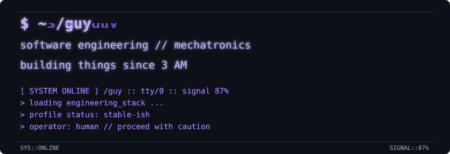

 

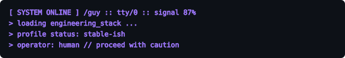

  <svg xmlns="http://www.w3.org/2000/svg" width="420" height="56" viewBox="0 0 420 56" role="img" aria-label="$ whoami">
    <g font-family="Fira Code, SFMono-Regular, Consolas, Liberation Mono, Menlo, monospace" font-weight="700" fill="#C4B5FD">
      <text x="18" y="36" font-size="26" lengthAdjust="spacingAndGlyphs" textLength="0">$ whoami
        <animate attributeName="textLength" values="0;220;220" dur="1.2s" begin="0s" fill="freeze"/>
        <animate attributeName="opacity" values="0;1" dur="0.18s" begin="0s" fill="freeze"/>
      </text>
      <rect x="214" y="18" width="12" height="23" rx="2" fill="#C4B5FD">
        <animate attributeName="opacity" values="0;1;0;1;0" dur="0.9s" begin="1.2s" repeatCount="indefinite"/>
      </rect>
    </g>
  </svg>

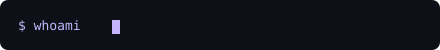

João Guilherme de O. Miranda. Online, just **Guy**.

I like purple; my interfaces are purple because I like them, not because I'm a "vibecoder"—just let me be happy.

Software Engineering student and Mechatronics technician. One taught me how to program; the other taught me to distrust any solution that only exists inside a screen.

Mechatronics is why I cannot look at a software problem without wondering how it would make a real motor move.

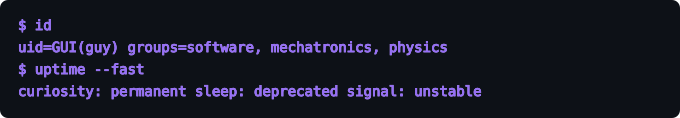

 

  <svg xmlns="http://www.w3.org/2000/svg" width="620" height="56" viewBox="0 0 620 56" role="img" aria-label="$ cat interests.txt">
    <g font-family="Fira Code, SFMono-Regular, Consolas, Liberation Mono, Menlo, monospace" font-weight="700" fill="#C4B5FD">
      <text x="18" y="36" font-size="26">
        <tspan opacity="0"><animate attributeName="opacity" values="0;1;1" dur="0.08s" begin="0s" fill="freeze"/>$</tspan>
        <tspan opacity="0"><animate attributeName="opacity" values="0;1;1" dur="0.08s" begin="0.12s" fill="freeze"/> </tspan>
        <tspan opacity="0"><animate attributeName="opacity" values="0;1;1" dur="0.08s" begin="0.22s" fill="freeze"/>c</tspan>
        <tspan opacity="0"><animate attributeName="opacity" values="0;1;1" dur="0.08s" begin="0.30s" fill="freeze"/>a</tspan>
        <tspan opacity="0"><animate attributeName="opacity" values="0;1;1" dur="0.08s" begin="0.38s" fill="freeze"/>t</tspan>
        <tspan opacity="0"><animate attributeName="opacity" values="0;1;1" dur="0.08s" begin="0.46s" fill="freeze"/> </tspan>
        <tspan opacity="0"><animate attributeName="opacity" values="0;1;1" dur="0.08s" begin="0.56s" fill="freeze"/>i</tspan>
        <tspan opacity="0"><animate attributeName="opacity" values="0;1;1" dur="0.08s" begin="0.64s" fill="freeze"/>n</tspan>
        <tspan opacity="0"><animate attributeName="opacity" values="0;1;1" dur="0.08s" begin="0.72s" fill="freeze"/>t</tspan>
        <tspan opacity="0"><animate attributeName="opacity" values="0;1;1" dur="0.08s" begin="0.80s" fill="freeze"/>e</tspan>
        <tspan opacity="0"><animate attributeName="opacity" values="0;1;1" dur="0.08s" begin="0.88s" fill="freeze"/>r</tspan>
        <tspan opacity="0"><animate attributeName="opacity" values="0;1;1" dur="0.08s" begin="0.96s" fill="freeze"/>e</tspan>
        <tspan opacity="0"><animate attributeName="opacity" values="0;1;1" dur="0.08s" begin="1.04s" fill="freeze"/>s</tspan>
        <tspan opacity="0"><animate attributeName="opacity" values="0;1;1" dur="0.08s" begin="1.12s" fill="freeze"/>t</tspan>
        <tspan opacity="0"><animate attributeName="opacity" values="0;1;1" dur="0.08s" begin="1.20s" fill="freeze"/>s</tspan>
        <tspan opacity="0"><animate attributeName="opacity" values="0;1;1" dur="0.08s" begin="1.28s" fill="freeze"/>.</tspan>
        <tspan opacity="0"><animate attributeName="opacity" values="0;1;1" dur="0.08s" begin="1.36s" fill="freeze"/>t</tspan>
        <tspan opacity="0"><animate attributeName="opacity" values="0;1;1" dur="0.08s" begin="1.44s" fill="freeze"/>x</tspan>
        <tspan opacity="0"><animate attributeName="opacity" values="0;1;1" dur="0.08s" begin="1.52s" fill="freeze"/>t</tspan>
      </text>
      <rect x="455" y="18" width="12" height="23" rx="2" fill="#C4B5FD">
        <animate attributeName="opacity" values="0;1;0;1;0" dur="0.8s" begin="1.5s" repeatCount="indefinite"/>
      </rect>
    </g>
  </svg>

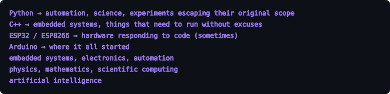

It started as a Physics exercise. It got a graph. Things escalated.

 

  <svg xmlns="http://www.w3.org/2000/svg" width="500" height="56" viewBox="0 0 500 56" role="img" aria-label="$ ls projects/">
    <g font-family="Fira Code, SFMono-Regular, Consolas, Liberation Mono, Menlo, monospace" font-weight="700" fill="#C4B5FD">
      <text x="18" y="36" font-size="26" lengthAdjust="spacingAndGlyphs" textLength="0">$ ls projects/
        <animate attributeName="textLength" values="0;260;260" dur="1.4s" begin="0s" fill="freeze"/>
        <animate attributeName="opacity" values="0;1" dur="0.18s" begin="0s" fill="freeze"/>
      </text>
      <rect x="258" y="18" width="12" height="23" rx="2" fill="#C4B5FD">
        <animate attributeName="opacity" values="0;1;0;1;0" dur="0.9s" begin="1.3s" repeatCount="indefinite"/>
      </rect>
    </g>
  </svg>

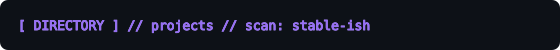

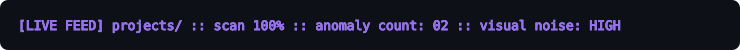

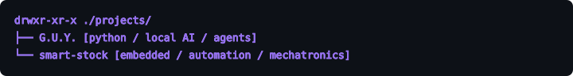

**[G.U.Y.](https://github.com/jguilhermemiranda/guy-I.A)**
A local AI in Python with memory, RAG, autonomous agents, and experimental neural architectures.

**[smart-stock](https://github.com/jguilhermemiranda/smart-stock)**
An automated inventory management system developed as the final project for my Mechatronics technical degree — embedded systems and automation applied to a real materials-control problem.

I have a dangerous habit of turning “this would be interesting to test” into a new repository. Both of the ones above survived the test of time.

 

  <svg xmlns="http://www.w3.org/2000/svg" width="920" height="56" viewBox="0 0 920 56" role="img" aria-label="$ tail -f learning_now.log">
    <g font-family="Fira Code, SFMono-Regular, Consolas, Liberation Mono, Menlo, monospace" font-weight="700" fill="#C4B5FD">
      <text x="18" y="36" font-size="26" lengthAdjust="spacingAndGlyphs" textLength="0">$ tail -f learning_now.log
        <animate attributeName="textLength" values="0;620;620" dur="2s" begin="0s" fill="freeze"/>
        <animate attributeName="opacity" values="0;1" dur="0.18s" begin="0s" fill="freeze"/>
      </text>
      <rect x="620" y="18" width="12" height="23" rx="2" fill="#C4B5FD">
        <animate attributeName="opacity" values="0;1;0;1;0" dur="0.9s" begin="1.8s" repeatCount="indefinite"/>
      </rect>
    </g>
  </svg>

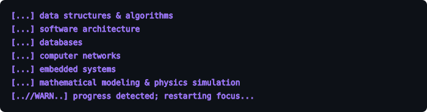

 

  <svg xmlns="http://www.w3.org/2000/svg" width="620" height="56" viewBox="0 0 620 56" role="img" aria-label="$ cat education.md">
    <g font-family="Fira Code, SFMono-Regular, Consolas, Liberation Mono, Menlo, monospace" font-weight="700" fill="#C4B5FD">
      <text x="18" y="36" font-size="26" lengthAdjust="spacingAndGlyphs" textLength="0">$ cat education.md
        <animate attributeName="textLength" values="0;330;330" dur="1.5s" begin="0s" fill="freeze"/>
        <animate attributeName="opacity" values="0;1" dur="0.18s" begin="0s" fill="freeze"/>
      </text>
      <rect x="332" y="18" width="12" height="23" rx="2" fill="#C4B5FD">
        <animate attributeName="opacity" values="0;1;0;1;0" dur="0.9s" begin="1.4s" repeatCount="indefinite"/>
      </rect>
    </g>
  </svg>

**Software Engineering** — UGB *(in progress)*
**Mechatronics Technician** — ICT *(completed)*

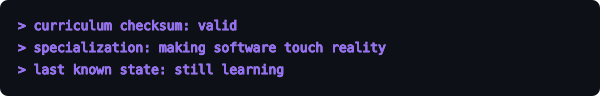

 

  <svg xmlns="http://www.w3.org/2000/svg" width="330" height="56" viewBox="0 0 330 56" role="img" aria-label="$ contact">
    <g font-family="Fira Code, SFMono-Regular, Consolas, Liberation Mono, Menlo, monospace" font-weight="700" fill="#C4B5FD">
      <text x="18" y="36" font-size="26" lengthAdjust="spacingAndGlyphs" textLength="0">$ contact
        <animate attributeName="textLength" values="0;150;150" dur="1.1s" begin="0s" fill="freeze"/>
        <animate attributeName="opacity" values="0;1" dur="0.18s" begin="0s" fill="freeze"/>
      </text>
      <rect x="152" y="18" width="12" height="23" rx="2" fill="#C4B5FD">
        <animate attributeName="opacity" values="0;1;0;1;0" dur="0.9s" begin="1s" repeatCount="indefinite"/>
      </rect>
    </g>
  </svg>

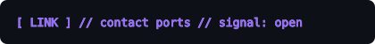

<!-- if you are reading the raw, you probably already know this commit works and does not work until someone runs the build -->

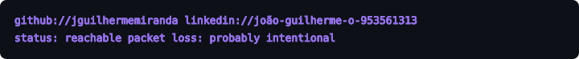

---

Guy — software engineering, mechatronics by origin

##  Contribution Graph


