

🇧🇷 Português | <a href="README.en.md">🇺🇸 English</a>

 

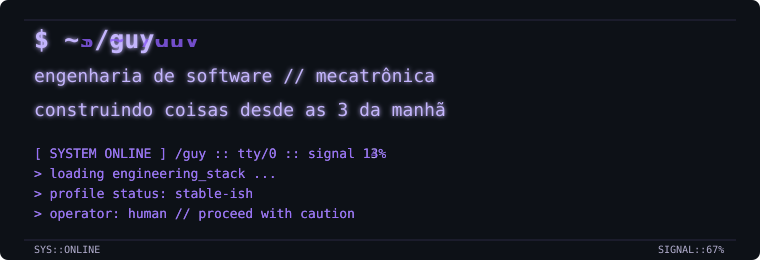

 

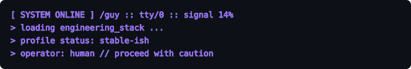

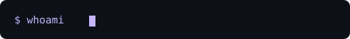

João Guilherme de O. Miranda. Online, só **Guy**.

eu gosto de roxo minhas interfaces são roxas pq eu gosto não pq eu sou vibecoder deixem eu ser feliz 

Estudante de Engenharia de Software, técnico em Mecatrônica. Uma formação me ensinou a programar, a outra me ensinou a desconfiar de qualquer solução que só exista dentro da tela.

A Mecatrônica é a razão de eu não conseguir olhar para um problema de software sem pensar em como ele tocaria um motor de verdade.

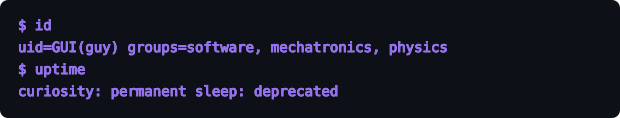

 

  <svg xmlns="http://www.w3.org/2000/svg" width="620" height="56" viewBox="0 0 620 56" role="img" aria-label="$ cat interesses.txt">
    <g font-family="Fira Code, SFMono-Regular, Consolas, Liberation Mono, Menlo, monospace" font-weight="700" fill="#C4B5FD">
      <text x="18" y="36" font-size="26">
        <tspan opacity="0"><animate attributeName="opacity" values="0;1;1" dur="0.08s" begin="0s" fill="freeze"/>$</tspan>
        <tspan opacity="0"><animate attributeName="opacity" values="0;1;1" dur="0.08s" begin="0.12s" fill="freeze"/> </tspan>
        <tspan opacity="0"><animate attributeName="opacity" values="0;1;1" dur="0.08s" begin="0.22s" fill="freeze"/>c</tspan>
        <tspan opacity="0"><animate attributeName="opacity" values="0;1;1" dur="0.08s" begin="0.30s" fill="freeze"/>a</tspan>
        <tspan opacity="0"><animate attributeName="opacity" values="0;1;1" dur="0.08s" begin="0.38s" fill="freeze"/>t</tspan>
        <tspan opacity="0"><animate attributeName="opacity" values="0;1;1" dur="0.08s" begin="0.46s" fill="freeze"/> </tspan>
        <tspan opacity="0"><animate attributeName="opacity" values="0;1;1" dur="0.08s" begin="0.56s" fill="freeze"/>i</tspan>
        <tspan opacity="0"><animate attributeName="opacity" values="0;1;1" dur="0.08s" begin="0.64s" fill="freeze"/>n</tspan>
        <tspan opacity="0"><animate attributeName="opacity" values="0;1;1" dur="0.08s" begin="0.72s" fill="freeze"/>t</tspan>
        <tspan opacity="0"><animate attributeName="opacity" values="0;1;1" dur="0.08s" begin="0.80s" fill="freeze"/>e</tspan>
        <tspan opacity="0"><animate attributeName="opacity" values="0;1;1" dur="0.08s" begin="0.88s" fill="freeze"/>r</tspan>
        <tspan opacity="0"><animate attributeName="opacity" values="0;1;1" dur="0.08s" begin="0.96s" fill="freeze"/>e</tspan>
        <tspan opacity="0"><animate attributeName="opacity" values="0;1;1" dur="0.08s" begin="1.04s" fill="freeze"/>s</tspan>
        <tspan opacity="0"><animate attributeName="opacity" values="0;1;1" dur="0.08s" begin="1.12s" fill="freeze"/>e</tspan>
        <tspan opacity="0"><animate attributeName="opacity" values="0;1;1" dur="0.08s" begin="1.20s" fill="freeze"/>s</tspan>
        <tspan opacity="0"><animate attributeName="opacity" values="0;1;1" dur="0.08s" begin="1.28s" fill="freeze"/>.</tspan>
        <tspan opacity="0"><animate attributeName="opacity" values="0;1;1" dur="0.08s" begin="1.36s" fill="freeze"/>t</tspan>
        <tspan opacity="0"><animate attributeName="opacity" values="0;1;1" dur="0.08s" begin="1.44s" fill="freeze"/>x</tspan>
        <tspan opacity="0"><animate attributeName="opacity" values="0;1;1" dur="0.08s" begin="1.52s" fill="freeze"/>t</tspan>
      </text>
      <rect x="455" y="18" width="12" height="23" rx="2" fill="#C4B5FD">
        <animate attributeName="opacity" values="0;1;0;1;0" dur="0.8s" begin="1.5s" repeatCount="indefinite"/>
      </rect>
    </g>
  </svg>

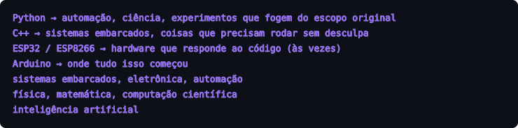

Começou como exercício de Física. Ganhou um gráfico. As coisas escalaram.

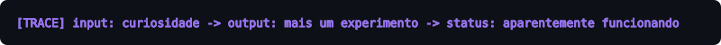

 

  <svg xmlns="http://www.w3.org/2000/svg" width="500" height="56" viewBox="0 0 500 56" role="img" aria-label="$ ls projetos/">
    <g font-family="Fira Code, SFMono-Regular, Consolas, Liberation Mono, Menlo, monospace" font-weight="700" fill="#C4B5FD">
      <text x="18" y="36" font-size="26" lengthAdjust="spacingAndGlyphs" textLength="0">$ ls projetos/
        <animate attributeName="textLength" values="0;260;260" dur="1.4s" begin="0s" fill="freeze"/>
        <animate attributeName="opacity" values="0;1" dur="0.18s" begin="0s" fill="freeze"/>
      </text>
      <rect x="258" y="18" width="12" height="23" rx="2" fill="#C4B5FD">
        <animate attributeName="opacity" values="0;1;0;1;0" dur="0.9s" begin="1.3s" repeatCount="indefinite"/>
      </rect>
    </g>
  </svg>

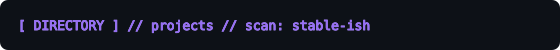

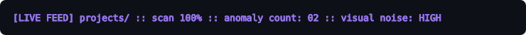

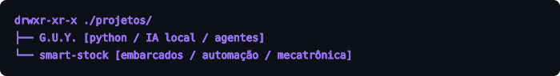

**[G.U.Y.](https://github.com/jguilhermemiranda/guy-I.A)**
Uma IA local em Python, com memória, RAG, agentes autônomos e arquiteturas neurais experimentais.

**[smart-stock](https://github.com/jguilhermemiranda/smart-stock)**
Sistema de gestão de estoque automatizado, TCC do técnico em Mecatrônica — embarcados e automação aplicados a um problema real de controle de materiais.

Tenho o hábito perigoso de transformar "isso seria interessante de testar" em um repositório novo. Os dois acima sobreviveram ao teste do tempo.

 

  <svg xmlns="http://www.w3.org/2000/svg" width="920" height="56" viewBox="0 0 920 56" role="img" aria-label="$ tail -f estudando_agora.log">
    <g font-family="Fira Code, SFMono-Regular, Consolas, Liberation Mono, Menlo, monospace" font-weight="700" fill="#C4B5FD">
      <text x="18" y="36" font-size="26" lengthAdjust="spacingAndGlyphs" textLength="0">$ tail -f estudando_agora.log
        <animate attributeName="textLength" values="0;620;620" dur="2s" begin="0s" fill="freeze"/>
        <animate attributeName="opacity" values="0;1" dur="0.18s" begin="0s" fill="freeze"/>
      </text>
      <rect x="620" y="18" width="12" height="23" rx="2" fill="#C4B5FD">
        <animate attributeName="opacity" values="0;1;0;1;0" dur="0.9s" begin="1.8s" repeatCount="indefinite"/>
      </rect>
    </g>
  </svg>

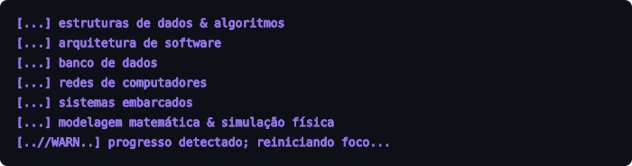

 

  <svg xmlns="http://www.w3.org/2000/svg" width="620" height="56" viewBox="0 0 620 56" role="img" aria-label="$ cat formacao.md">
    <g font-family="Fira Code, SFMono-Regular, Consolas, Liberation Mono, Menlo, monospace" font-weight="700" fill="#C4B5FD">
      <text x="18" y="36" font-size="26" lengthAdjust="spacingAndGlyphs" textLength="0">$ cat formacao.md
        <animate attributeName="textLength" values="0;330;330" dur="1.5s" begin="0s" fill="freeze"/>
        <animate attributeName="opacity" values="0;1" dur="0.18s" begin="0s" fill="freeze"/>
      </text>
      <rect x="332" y="18" width="12" height="23" rx="2" fill="#C4B5FD">
        <animate attributeName="opacity" values="0;1;0;1;0" dur="0.9s" begin="1.4s" repeatCount="indefinite"/>
      </rect>
    </g>
  </svg>

**Engenharia de Software** — UGB *(em andamento)*
**Técnico em Mecatrônica** — ICT *(concluído)*

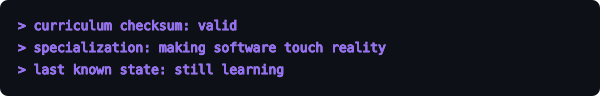

 

  <svg xmlns="http://www.w3.org/2000/svg" width="330" height="56" viewBox="0 0 330 56" role="img" aria-label="$ contact">
    <g font-family="Fira Code, SFMono-Regular, Consolas, Liberation Mono, Menlo, monospace" font-weight="700" fill="#C4B5FD">
      <text x="18" y="36" font-size="26" lengthAdjust="spacingAndGlyphs" textLength="0">$ contact
        <animate attributeName="textLength" values="0;150;150" dur="1.1s" begin="0s" fill="freeze"/>
        <animate attributeName="opacity" values="0;1" dur="0.18s" begin="0s" fill="freeze"/>
      </text>
      <rect x="152" y="18" width="12" height="23" rx="2" fill="#C4B5FD">
        <animate attributeName="opacity" values="0;1;0;1;0" dur="0.9s" begin="1s" repeatCount="indefinite"/>
      </rect>
    </g>
  </svg>

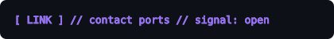

<!-- se você está lendo o raw, provavelmente já sabe que este commit funciona e não funciona até alguém rodar o build -->

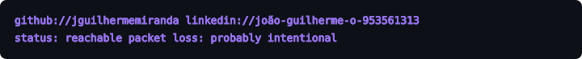

---

Guy — engenharia de software, mecatrônica de origem

##  Contribution Graph


